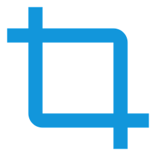

# ScreenPin

Windows 10/11 screenshot-to-pin utility, written in C++23 with Win32 and GDI+.

[](https://github.com/Retuze/ScreenPin/releases)

<p align="center">
  
</p>

截图后不进入编辑器，直接把选区贴到屏幕上。

## 功能

- 全局热键 `Alt+Shift+S`，全屏框选
- 选区时背景调暗、十字光标、放大镜、实时尺寸标签
- `Esc` 或右键取消，截完自动贴到屏幕原位置
- 同时复制到剪贴板
- 贴图始终置顶，可拖动、双击关闭
- 滚轮调透明度（10%–100%）
- `Ctrl + 滚轮`缩放（0.1x–8x，以光标为锚点）
- `Ctrl + 左键拖四边/四角`裁剪（可在原截图范围内恢复）
- 贴图只有方向性阴影（顶部淡、底部有接触阴影），没有边框线
- 右键菜单：复制图片 / 另存为 PNG / 关闭 / 关闭全部
- 托盘右键菜单可开关开机自启动（HKCU Run，不需要管理员权限）
- 托盘图标与菜单、单实例、PerMonitorV2、多显示器

## 使用

| 操作 | 行为 |
| --- | --- |
| `Alt+Shift+S` | 开始截图；热键冲突时可用托盘菜单 |
| 拖动鼠标 | 框选区域 |
| `Esc` / 右键 | 取消截图 |
| 拖动贴图 | 移动位置 |
| 双击贴图 | 关闭 |
| 滚轮 | 调整不透明度 |
| `Ctrl + 滚轮` | 调整大小 |
| `Ctrl + 左键拖边缘` | 裁剪该边缘 |
| 右键贴图 | 复制 / 另存 PNG / 关闭 |
| `Ctrl+C` / `Ctrl+S` | 贴图获得焦点时复制 / 另存 PNG |
| 托盘右键 → 开机自启动 | 勾选/取消当前用户登录时启动 |

> Windows 自带的截图热键是 `Win+Shift+S`，但 Win 组合会被系统截获。这里使用 `Alt+Shift+S`，实测不会触发输入法布局切换；个别机器若仍把 `Alt+Shift` 用作输入法切换，可用托盘菜单截图。

## 构建

### 依赖

- Windows 10/11 x64
- PowerShell 7+
- Visual Studio 2022 Build Tools，安装 **Desktop development with C++** 工作负载（MSVC v143 + Windows SDK）

### 命令

```powershell
.\build.ps1
```

产物：`dist\ScreenPin.exe`（`cl.exe /std:c++latest /MT`，不依赖 VC++ Redistributable）。

可选参数：

```powershell
.\build.ps1 -Clean
```

构建脚本通过 `vswhere` 定位 Visual Studio，在 `vcvars64.bat` 环境里调用 `cl.exe` 和 `rc.exe`；源码和脚本中不包含固定安装路径。

> 重新构建前请先退出托盘中的 ScreenPin，否则 `dist\ScreenPin.exe` 会被占用。

## 目录

```text
src/
  main.cpp         wWinMain
  app.*            托盘、全局热键、单实例、生命周期
  overlay.*        截屏 + 全屏选区覆盖层
  pin_window.*     贴图窗口、交互、阴影合成
  common.*         DIB、截屏、剪贴板、PNG、DPI/几何
resources/
  app.rc           图标、manifest、VERSIONINFO
  app.manifest     PerMonitorV2、longPathAware
  app.ico
  app.svg          图标源文件
docs/
  preview-16-big.png   16px 图标放大预览
build.ps1
LICENSE
```

## 实现要点

- **截屏**：`EnumDisplayMonitors` + 每个显示器 `CreateDC` + `BitBlt(SRCCOPY | CAPTUREBLT)`，写入 top-down 32bpp DIB；失败时回退 `GetDC(NULL)`。
- **选区层**：覆盖整个虚拟屏幕的 `WS_EX_TOPMOST` 窗口。绘制走双缓冲：暗化背景、高亮选区、尺寸标签、放大镜先画到离屏 canvas，再一次 `BitBlt` 到窗口，鼠标拖动时不会出现半帧闪烁。
- **贴图窗口**：`WS_EX_LAYERED` + `UpdateLayeredWindow` 的逐像素 alpha；窗口比图像大一圈透明边距，边距返回 `HTTRANSPARENT`，鼠标可以穿透。
- **阴影**：半分辨率 alpha mask 上生成三层——“环境光晕”（0 偏移、大半径、约 10%）、“环境阴影”（向下 8px、大半径）和“接触阴影”（向下 2px、小半径），二维 box blur 后双线性放大合成。顶部几乎不出阴影，底部最重，没有边框线。
- **变换模型**：`source image + crop rect + scale + screen rect`。缩放时固定光标下的图像点；裁剪在源像素坐标里计算，再按 `scale` 反推屏幕边缘，避免连续拖动累积误差。
- **剪贴板 / PNG**：自底向上 24bpp `CF_DIB`；PNG 使用 GDI+ encoder。
- **热键 / 托盘**：`RegisterHotKey` + `MOD_NOREPEAT`；注册失败用托盘气泡提示。托盘宿主是一个 1×1 的屏幕外可见窗口，这样弹出菜单能拿到前台焦点，`Esc`/点击外部可以正常关闭；同时处理 Explorer 重启后的 `TaskbarCreated` 消息。
- **开机自启动**：在 `HKEY_CURRENT_USER\Software\Microsoft\Windows\CurrentVersion\Run` 写入 `ScreenPin` 值，命令是带引号的当前 exe 路径；只影响当前用户，无需管理员权限。

## 已知限制

- 受 DRM/独占全屏保护的内容可能截成黑屏（`CAPTUREBLT` 也无能为力）。
- 选区覆盖层每次鼠标移动重绘整个虚拟屏幕；4K 多屏环境下可能不够跟手。
- 滚轮作用于未聚焦贴图依赖 Windows 的“悬停时滚动非活动窗口”设置（默认开启）；若关闭，先点一下贴图。
- 不支持滚动截图、窗口自动识别、标注/OCR、多选管理等扩展功能。
- 缩放使用 GDI+ 双三次采样，极大放大时仍是像素插值，不适合当图片查看器。
- 贴图阴影固定 24 DIP 边距，不随贴图尺寸缩放。
- 透明度、缩放比例、位置不会持久化，退出后不保留。
- 移动 exe 文件后，注册表里的自启动路径会失效，需要重新勾选“开机自启动”。
- 截图不包含鼠标指针。
- 调试：设置环境变量 `SCREENPIN_LOG=1` 后，关键事件追加到 `%TEMP%\ScreenPin.log`；默认不写日志。

## 图标

源文件是 `resources/app.svg`，`app.ico` / `app.png` 已生成 16–256 多尺寸、透明底。

修改图标时，用任意 SVG 渲染器导出 1024×1024 PNG，再打包成 ICO 即可；构建本身不依赖图标生成工具。

16px 效果预览：[docs/preview-16-big.png](docs/preview-16-big.png)

## License

MIT © 2026 deepseek. See [LICENSE](LICENSE).
